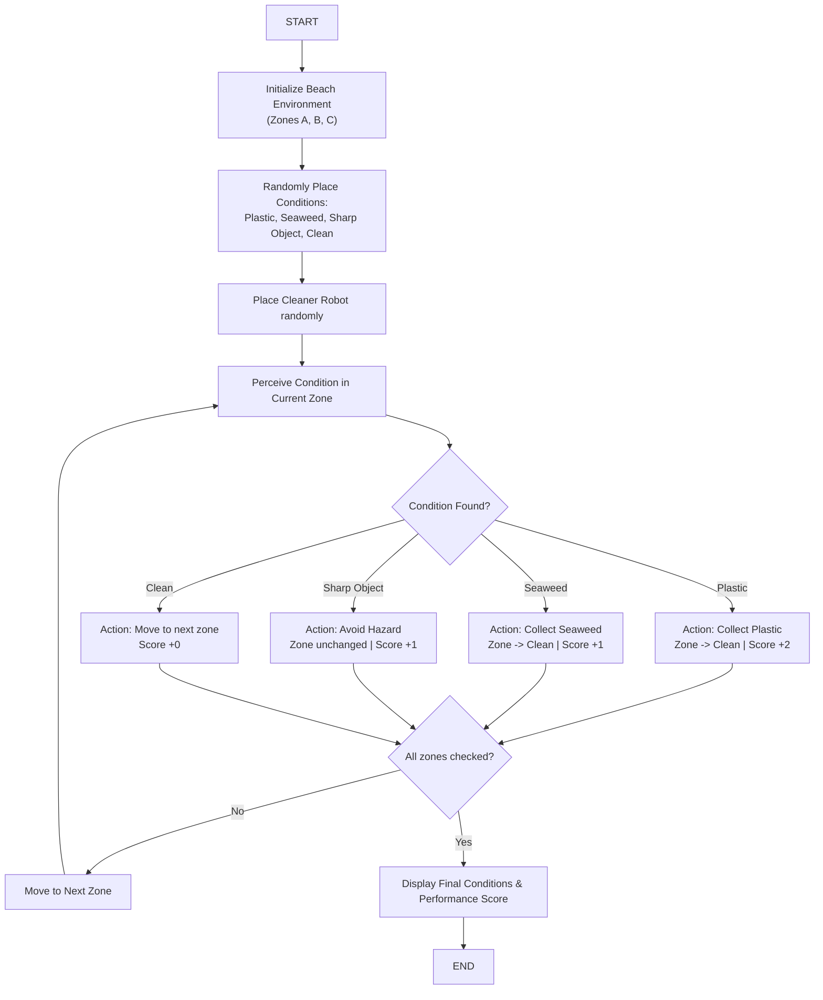

# Practical 1.1: Intelligent Agent - Simple Reflex Agent

**Title:** AI-Based Smart Beach Cleaning Vacuum Cleaner  
**Author:** Shruti Siddheshwar Thorat  
**Batch:** A1 | **Roll No:** 16 | **PRN:** 202401040053  

---

## 📌 Aim
To design and simulate an intelligent beach-cleaning agent that can detect different conditions in beach zones and automatically select an appropriate cleaning or safety action.

---

## 🎯 Objectives
- Develop an intelligent agent that performs cleaning activities using AI principles.
- Simulate a beach environment with diverse environmental conditions: `Clean`, `Plastic`, `Seaweed`, and `Sharp Object`.
- Implement rule-based condition-action mappings (`if-then` rules) characteristic of a **Simple Reflex Agent**.
- Avoid hazardous items (`Sharp Object`) to guarantee agent safety.
- Quantitatively evaluate agent effectiveness using an accumulated performance metric.

---

## ⚙️ Architecture & Working



---

## 📊 Condition-Action Rules & Scoring Matrix

| Detected Percept | Actuator Response | Environment Update | Performance Reward |
|---|---|---|---|
| **Plastic** | Collect plastic waste | Status becomes `Clean` | **+2** |
| **Seaweed** | Collect organic seaweed | Status becomes `Clean` | **+1** |
| **Sharp Object** | Detect hazard, bypass / move around safely | Remains `Sharp Object` (Safety first) | **+1** |
| **Clean** | No action required, proceed to next zone | Remains `Clean` | **0** |

---

## 🚀 Execution Instructions

Run the script locally:
```bash
python beach_cleaning_agent.py
```

### Sample Output
```text
========================================
          BEACH CLEANING 
========================================

Initial Beach Conditions:
{'Zone A': 'Sharp Object', 'Zone B': 'Plastic', 'Zone C': 'Clean'}

Robot starts at: Zone A

----------------------------------------
Vaccum is at: Zone A
Condition found: Sharp Object
Sharp object detected!
Action: Avoiding the object...
Robot safely moved around it.
Score +1
Moving to the next beach zone...

----------------------------------------
Vaccum is at: Zone B
Condition found: Plastic
Plastic waste detected!
Action: Collecting plastic waste...
Plastic collected successfully.
Score +2
Moving to the next beach zone...

----------------------------------------
Vaccum is at: Zone C
Condition found: Clean
Zone is already clean.
Action: Moving to the next zone.

========================================
          CLEANING COMPLETED
========================================
Final Beach Conditions:
{'Zone A': 'Sharp Object', 'Zone B': 'Clean', 'Zone C': 'Clean'}

Final Performance Score: 3
Beach cleaning task completed successfully!
```
